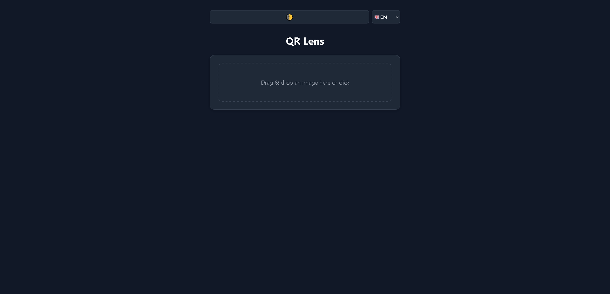
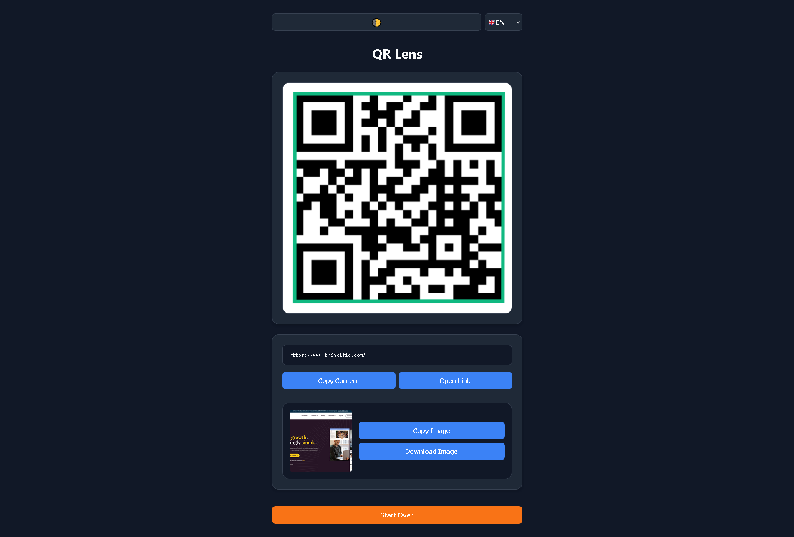

<h1>📄 QR Lens Extractor 🔍</h1>

A modern, lightning-fast, client-side web app to instantly extract links and content from QR codes. Featuring drag-and-drop, visual code highlighting, live URL previews, and full multilingual support.

  <a href="http://paypal.me/R0mb0">
    <picture>
      <source media="(prefers-color-scheme: dark)" srcset="https://github.com/R0mb0/Support_the_dev_badge/blob/main/Badge/SVG/Support_the_dev_badge_Dark.svg">
      <source media="(prefers-color-scheme: light)" srcset="https://github.com/R0mb0/Support_the_dev_badge/blob/main/Badge/SVG/Support_the_dev_badge_Light.svg">
      
    </picture>
  </a>

---

<h2><a href="https://r0mb0.github.io/Qr_lens_extractor/">👉 Click here to test the app! 👈</a></h2>

<h2>🚀 Features</h2>
<ul>
<li><strong>Local Processing</strong>: The core QR decoding happens entirely in your browser using <code>jsQR</code>. Your images are never uploaded to a server!</li>
<li><strong>Live Web Previews</strong>: If the QR code contains a URL, the app automatically fetches and displays a thumbnail screenshot of the destination page using the Microlink API.</li>
<li><strong>Visual Feedback</strong>: Once decoded, the app highlights the exact position of the QR code directly on the image with a green bounding box.</li>
<li><strong>Multilingual Support</strong>: Automatically detects your browser language or lets you manually switch between 6 European languages (EN, IT, ES, FR, DE, PT). Preferences are saved locally!</li>
<li><strong>Modern UI</strong>: Fast, responsive, and adaptive Dark/Light mode interface based on your system preferences, with manual override controls.</li>
<li><strong>Advanced Clipboard Integration</strong>: Copy the extracted link or download/copy the generated website preview image straight to your clipboard with one click.</li>
</ul>

<h2>🛠️ How it works</h2>
<ol>
<li><strong>Drag and drop</strong> your image file into the dropzone (or click to browse).</li>
<li>The app draws the image on a hidden HTML5 canvas and scans the pixels for QR patterns.</li>
<li>If found, the image is displayed with the QR code highlighted.</li>
<li>If the result is a web link, an API call is made to generate a website screenshot.</li>
<li>Use the action buttons to copy the content, open the link, or save the preview image!</li>
</ol>

<h2>🏆 What makes it special?</h2>
<ul>
<li><strong>Single-File Architecture</strong>: HTML, CSS, and vanilla JavaScript are bundled into a single file. No build steps, no Node modules, no complex setup.</li>
<li><strong>Zero Dependencies</strong>: Aside from the lightweight <code>jsQR</code> script fetched via CDN, everything is built from scratch using native Web APIs.</li>
</ul>

<h2>💡 Why use this tool?</h2>
<ul>
<li><strong>Desktop Convenience</strong>: Easily read QR codes from screenshots, flyers, or documents directly on your PC without needing to pull out your smartphone.</li>
<li><strong>Link Verification</strong>: Safely check where a QR code points to and view a preview of the webpage before actually visiting it on your main browser.</li>
</ul>

<h2>⚡ Getting Started</h2>

<h3>Online</h3>

Simply visit the <a href="https://r0mb0.github.io/Qr_lens_extractor/">Live Demo hosted on GitHub Pages</a>.

<h3>Local Installation</h3>

Running this tool locally is ridiculously easy:

<ol>
<li><strong>Clone this repository</strong> or simply download the <code>index.html</code> file.</li>
<li>Double-click <code>index.html</code> to open it in your favorite browser.</li>
<li>Done. <em>(Note: An internet connection is only required to load the jsQR CDN and fetch the live URL previews)</em>.</li>
</ol>

<a href="https://github.com/R0mb0/Crafted_with_AI">
<picture>
<source media="(prefers-color-scheme: dark)" srcset="https://github.com/R0mb0/Crafted_with_AI/blob/main/Badge/SVG/CraftedWithAIDark.svg">
<source media="(prefers-color-scheme: light)" srcset="https://github.com/R0mb0/Crafted_with_AI/blob/main/Badge/SVG/NotMadeByAILight.svg">

</picture>
</a>
